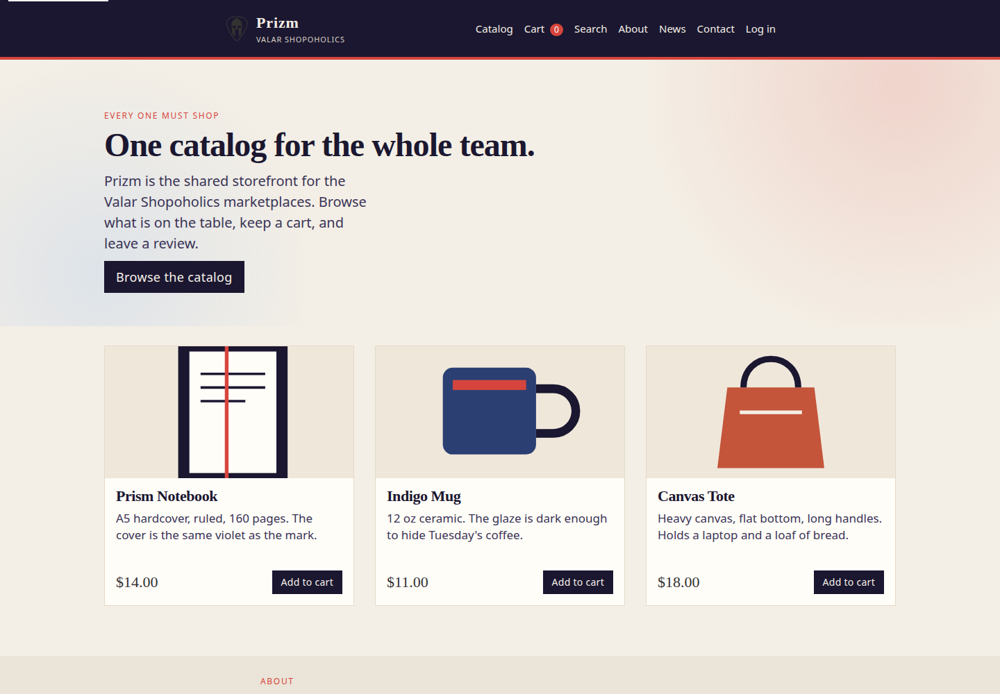
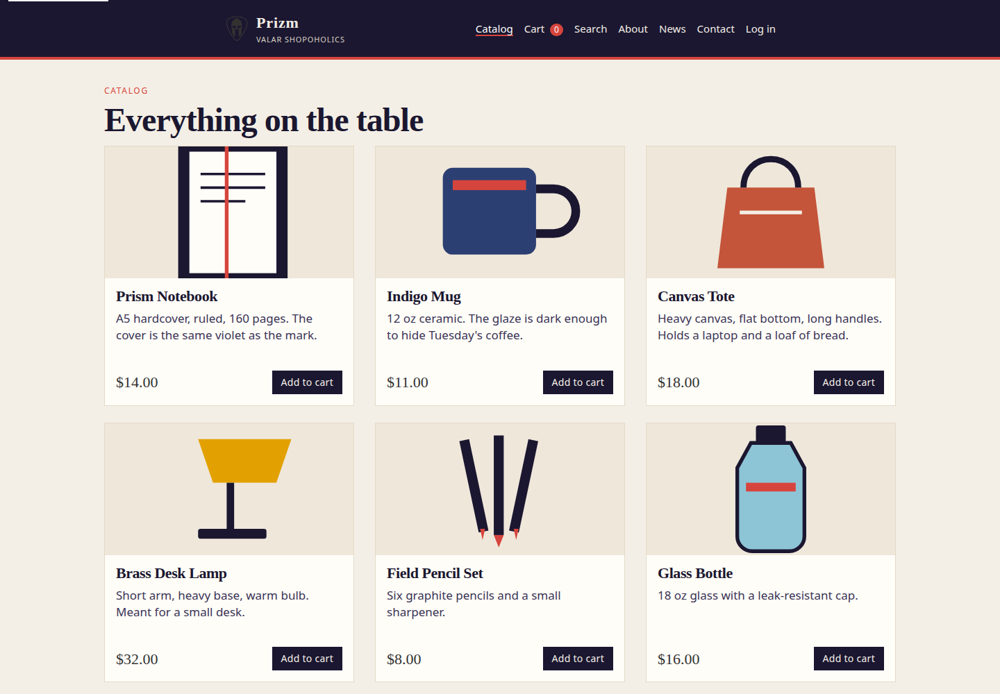
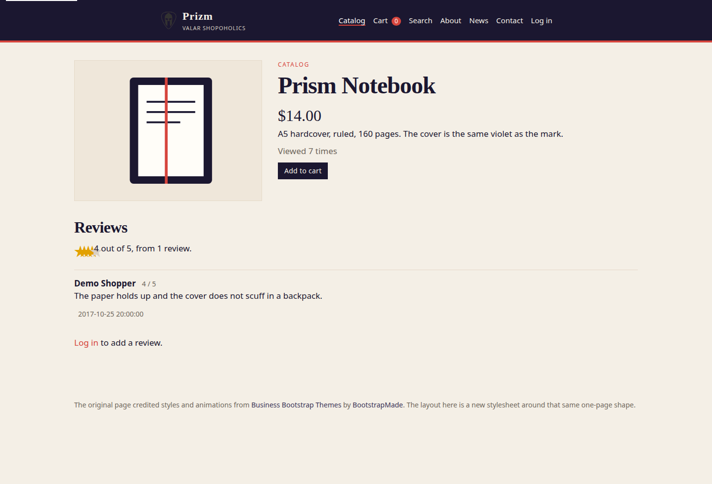
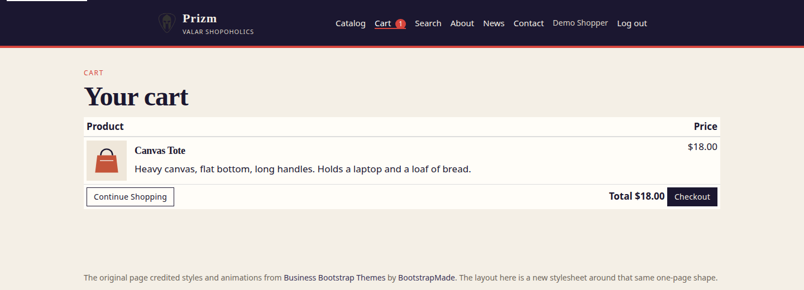

# Prizm

Prizm is a small shared storefront: one catalog, a session cart, star reviews, and a recommendation list built from past orders. The pages call the shop **Valar Shopoholics** and the tagline **Every One Must Shop**.



## Original context

This repository was opened on September 11, 2017 by Pranav Prem. The only line in the first README was:

> An common website for six online marketplaces with products from all, PayPal and Facebook integration

On October 25, 2017, Parag Vijayvergia (`parag.vijayvergia@sjsu.edu`) committed the shopping-cart PHP. That commit is the rest of the history. The page titles in it already say "Every One Must Shop - Valar Shopoholics", and `user_recommend.php` connected to a MySQL database named `272project`.

Nothing in the repo names a course or a professor. The `@sjsu.edu` commit, the fall 2017 dates, and the database name line up with San Jose State's CMPE 272 (Enterprise Software Platforms). Pranav's other public repos from that year are labeled as CMPE 273 coursework. Treat the course link as a strong inference, not as something the code itself states.

What that October commit actually contained was a fragment:

- `index.php` pulled in `includes/head.php`, `home.php`, `navbar.php`, `about.php`, `news.php`, `contacts.php`, `login.php`, and `newuser.php`. None of those files were committed.
- Product links pointed at `displayproduct.php`, which was not committed.
- Catalog and cart queries used the old `mysql_*` API and `include('config.php')`, and `config.php` was not committed.
- `user_recommend.php` opened MySQL on its own as `root` with an empty password.
- `buildAllProducts()` in `util.php` fetched `https://localhost/valarshopoholics/exposeproducts.php` three times (the same URL, not six shops), turned off TLS verification, and then threw the HTML away.
- PayPal and Facebook appear only in that one README sentence. They are not in the PHP, the JavaScript, or either commit.

So the "six marketplaces, PayPal, Facebook" description is the project pitch. The code that landed here is one shop's catalog, cart, reviews, and a recommendation query.

## How it works

A shopper browses `allproducts.php`, opens a product, and adds it to the cart. The cart lives in the PHP session and only accepts products that exist. Checkout writes rows into `orders` and `ordermap`. It does not call PayPal. `user_recommend.php?uid=` lists the distinct products from that user's orders, which is what the 2017 query was trying to do.

Reviews go to `newreview.php` and show up on the product page. Search is a normal form plus a jQuery UI autocomplete against `products.json.php`.

Partner shops are optional. `exposeproducts.php` prints this catalog as JSON (`id`, `name`, `description`, `price`, `imgUrl`). Set `PRIZM_PEER_URLS` to feeds of that shape and the catalog page appends them as read-only cards. TLS certificates are checked. The old hard-coded localhost URL is not called.

```
browser
  index.php, allproducts.php, displayproduct.php, cart.php, search.php
        |
        v
  util.php  ->  lib/html.php  (markup)
            ->  lib/catalog.php (queries, cart, reviews, orders)
            ->  lib/bootstrap.php (env, PDO, schema, sample data)
        |
        v
  SQLite file data/prizm.sqlite    or    MySQL database 272project
```

## How to run it today

You need PHP 8.3 or newer, with `pdo_sqlite`, `mbstring`, and `curl`. [Composer](https://getcomposer.org/) is used for the test and format tools. No `.env` file is required.

```bash
composer install
composer serve
```

Then open http://127.0.0.1:8080

`composer serve` runs `php -S localhost:8080 router.php`. The router is what keeps the SQLite file, `.env`, and `lib/` from being downloaded. Use that command rather than pointing the built-in server at the directory with no router.

On the first request the app creates `data/prizm.sqlite`, builds the tables, and loads six sample products plus one shopper:

| | |
| --- | --- |
| Email | `demo@prizm.test` |
| Password | `demo` |

That account is for a local demo. Before putting the app anywhere public, set `PRIZM_SEED=0` and do not keep this password. Override the email or password in `.env` **before** the first run if you want different sample credentials. Copy `.env.example` to `.env` for the full list.

Log in, add something to the cart, and open checkout. The confirmation page records an order locally. Recommendations for the sample shopper are at http://127.0.0.1:8080/user_recommend.php?uid=1

### MySQL

The original database name was `272project`. To use MySQL instead of SQLite, create that database and set:

```bash
PRIZM_DB_DRIVER=mysql
PRIZM_DB_HOST=127.0.0.1
PRIZM_DB_NAME=272project
PRIZM_DB_USER=prizm
PRIZM_DB_PASS=choose-one
```

The app creates tables on connect. `sql/schema.mysql.sql` is the same schema for setting it up by hand. There is no shipped data dump from 2017.

### Tests and formatting

```bash
composer test
composer lint
```

`composer test` runs PHPUnit on an in-memory SQLite database. GitHub Actions also runs the suite on MySQL 8.4.

## Tech stack

- PHP 8.3+ (8.4 is covered in CI). Pages are plain PHP, not a framework.
- PDO. SQLite by default, MySQL when `PRIZM_DB_DRIVER=mysql`.
- Bootstrap 3.4.1, jQuery 3.7.1, and jQuery UI 1.13.3 from jsDelivr, plus Font Awesome 4.7.0. The old checked-in copies of jQuery and Bootstrap were unused by the pages and have been removed.
- PHPUnit 11.5 and PHP CS Fixer 3, pinned in `composer.lock`.
- Session cart. Passwords are stored with `password_hash()`.

## Project structure

```
index.php              one-page intro (home, about, news, contact, login, register)
allproducts.php        local catalog, plus partner cards when PRIZM_PEER_URLS is set
displayproduct.php     product, hits, stars, reviews
cart.php               session cart
addtocart.php          adds a product; requires login and the CSRF token
checkout.php           writes orders / ordermap; no payment
search.php             filter plus autocomplete
products.json.php      autocomplete JSON
exposeproducts.php     this shop's catalog as JSON, for other shops to fetch
user_recommend.php     products a user has ordered (?uid=)
newreview.php          saves a review
login.php register.php logout.php
starrating.php         preview of the star widget
includes/              header, navigation, and the sections index.php composes
lib/bootstrap.php      environment, connection, schema, sample data
lib/catalog.php        queries, auth, cart, orders, reviews
lib/html.php           the 2017 markup helpers (createProductUI, buildCartUI, ...)
css/ js/ images/       layout, behavior, sample product art
sql/schema.mysql.sql   optional MySQL DDL
router.php             blocks private paths on the built-in server
tests/                 PHPUnit
.github/workflows/ci.yml
```

`util.php` and `config.php` are still the files the old pages included. They load `lib/`.

## Screenshots

Home, catalog, a product with its sample review, and the cart after login.







The sample pictures are drawn SVGs in `images/`. The old `try/` directory was a pile of unrelated desktop wallpapers (several megabytes, not referenced by any page). Those files are gone from the tree. They are still in the October 2017 commit if you need them.

## Credentials

No PayPal client id, Facebook app secret, or other API key is in this repository, including the two historical commits. There is nothing of that kind to rotate.

The 2017 `user_recommend.php` did hard-code a database login: host `localhost`, user `root`, password empty, database `272project`. That login has been removed. Connection settings now come from the environment (see `.env.example`). If a machine was actually left with MySQL root and an empty password because of this project, lock that account down. The empty password was never a third-party secret, but it is a bad database setup.

The sample shopper password `demo` is a local seed, documented above, not a production credential.
